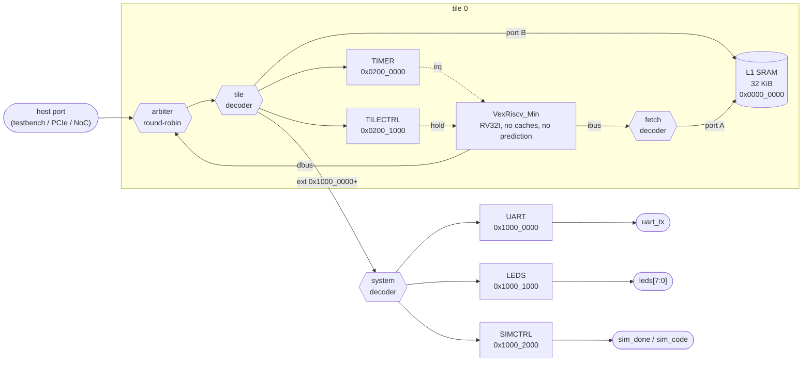
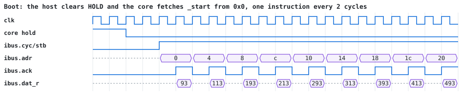
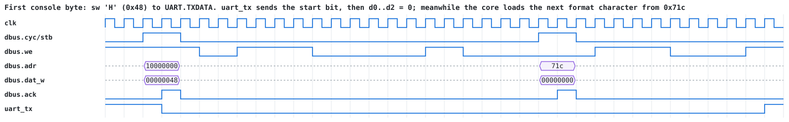

# rvgrid

[](https://github.com/Aleksandar1567/rvgrid/actions/workflows/ci.yml)
[](vendor/vexriscv/README.md)
[](pyproject.toml)
[](https://amaranth-lang.org)
[](docs/04-simulation.md)
[](docs/04-simulation.md)
[](LICENSE)

A custom RISC-V system-on-chip written in **Python** with
[Amaranth HDL](https://amaranth-lang.org), running C programs on a
[VexRiscv](https://github.com/SpinalHDL/VexRiscv) core. It is simulated with
[cocotb](https://www.cocotb.org) + [Verilator](https://verilator.org), and
everything is tested with `pytest`.

It's built as ordinary software: plain text files, one command to test,
no vendor GUI, so humans and AI agents can both work on it (see
[CLAUDE.md](CLAUDE.md)). The long-term direction is a Tenstorrent-style grid of
small RISC-V tiles, each with its own SRAM, that a host loads with kernels
([roadmap](docs/05-roadmap.md)).

```
$ python -m rvgrid sim hello
----- uart -----
Hello from RISC-V! tile=0
fib(12) = 144 in 18434 cycles
----------------
exit code 0  cycles 27685  leds 0x80
```

## What's in it

<!-- rvgrid:generated:begin -->


| Region | Base | End | Size | Scope | What |
|---|---|---|---|---|---|
| `L1` | `0x0000_0000` | `0x0000_7FFF` | 32 KiB | tile | Dual-port SRAM: code, data, stack |
| `TIMER` | `0x0200_0000` | `0x0200_0FFF` | 4 KiB | tile | Machine timer (mtime / mtimecmp) |
| `TILECTRL` | `0x0200_1000` | `0x0200_1FFF` | 4 KiB | tile | Tile id, core reset, bus errors |
| `UART` | `0x1000_0000` | `0x1000_0FFF` | 4 KiB | system | Console (8N1 transmitter) |
| `LEDS` | `0x1000_1000` | `0x1000_1FFF` | 4 KiB | system | 8 output pins |
| `SIMCTRL` | `0x1000_2000` | `0x1000_2FFF` | 4 KiB | system | Simulation exit code |
| *(anything else)* | | | | | bus error: ERR, recorded in `TILECTRL.BUSERR_*` |
<!-- rvgrid:generated:end -->

*Generated from [`rvgrid/config.py`](rvgrid/config.py) by `python -m rvgrid diagram`.
Register tables: [docs/generated/architecture.md](docs/generated/architecture.md).*

- **Tile** = VexRiscv_Min (RV32I, no caches, no branch prediction) + 32 KiB
  dual-port L1 SRAM + machine timer + tile control, on a Wishbone decoder with
  a round-robin arbiter. The tile is the unit that gets replicated later.
- **SoC** = tile(s) + a shared system bus with UART, LEDs and a
  simulation-exit register, plus a **host port** that loads programs into L1
  while the core is held in reset.
- **Firmware**: startup code, linker script, trap handling, `printf`, and
  four programs: `hello`, `memtest`, `timer_irq`, `traps`.
- **Tests** (23): unit tests in Amaranth's Python simulator (no external
  tools, seconds), and system tests booting real firmware in Verilator and
  Icarus, including a determinism test. Both simulators count the same
  27685 cycles for `hello`.
- **Diagrams**: Mermaid block diagram + memory map (above), waveforms and
  netlist schematics, all generated from the code and the simulator.
- **FPGA estimate**: `python -m rvgrid synth` → Yosys + nextpnr on an ECP5-25F.

## Seen in the simulator

The first cycles after the host releases the core, from the real `hello` run
(`python -m rvgrid sim hello --waves`, then `python -m rvgrid diagram`):



The first console byte, from the store instruction to the serial line:



The address decoder as Yosys sees it (`docs/img/decoder_netlist.svg`):
two address compares, response muxes and the one-cycle ERR flop for unmapped
addresses.


## FPGA estimate

`python -m rvgrid synth`: one tile with `hello` baked into L1, on a Lattice
LFE5U-25F (the chip on ~€30-50 boards such as Colorlight i5 or ULX3S):

| Resource | Used | Available |
|---|---|---|
| LUT4 + carry (TRELLIS_COMB) | 2309 | 24288 |
| Flip-flops | 1278 | 24288 |
| Block RAM (DP16KD) | 34 | 56 |
| **Fmax** (nextpnr) | **85.9 MHz** | target 50 MHz |

Block RAM is the limit: Yosys builds L1 (one read port + one read/write port
with byte enables) as two copies, 32 DP16KD instead of 16. Why is still open
(see the roadmap); fixing it comes first when more tiles need to fit.

## Quick start

```bash
make setup          # .venv + Python deps; EDA tools + RISC-V GCC into ~/tools (1.2 GB download, 4 GB unpacked, no sudo)
source env.sh       # puts .venv, RISC-V GCC and OSS CAD Suite on PATH

pytest              # all tests
python -m rvgrid sim hello            # boot a program, see its console
python -m rvgrid sim hello --waves    # + waveform, then:
gtkwave build/sim/verilator-waves/runs/hello/dump.vcd docs/hello.gtkw
```

Only want to edit RTL? `pip install -e '.[dev]' && pytest tests/unit` needs
nothing else.

## What a SoC needs besides the CPU

The short answer, from [docs/01-what-a-soc-needs.md](docs/01-what-a-soc-needs.md):

| Hardware | Software |
|---|---|
| clock + reset, and a way to **hold the core** in reset | cross compiler (`-march=rv32i_zicsr -mabi=ilp32`) |
| a **bus**: protocol, address decoder, arbiter, error response | startup code: `sp`, `gp`, zero `.bss`, `mtvec` |
| **memory** at the reset vector, plus RAM for data and stack | linker script matching the memory map |
| a way to **get the program in** (baked image or host loader) | register header for the peripherals |
| **timer** + interrupt line | trap handler |
| **console** (UART) | tiny libc (`printf`, `memset`, …) + libgcc |
| identity / status / error capture | |
| **simulation exit** register | |

…and **one memory map** that the RTL, the C header, the linker script and the
docs are all generated from.

## Repository layout

```
rvgrid/                 the hardware, in Python
  config.py             memory map + parameters  ← single source of truth
  bus/wishbone.py       bus signature, decoder, arbiter
  mem/sram.py           dual-port L1
  periph/               uart, timer, tilectrl, leds, simctrl
  cpu/vexriscv.py       VexRiscv wrapper (Verilog black box)
  tile.py, soc.py       structure
  gen.py                → Verilog, soc.h, memory.ld
  diagram.py, synth.py  → docs, schematics, FPGA estimate
  sim/                  Amaranth + cocotb bus models, harness, runner
sw/
  common/               start.S, link.ld, lib.c, rvgrid.h
  apps/<name>/          one program per directory
tests/unit/             Amaranth simulator, no external tools
tests/system/           cocotb + Verilator, real firmware
vendor/vexriscv/        pre-generated VexRiscv Verilog (MIT)
docs/                   explanations (start with 01)
scripts/setup-tools.sh  pinned OSS CAD Suite + xPack RISC-V GCC
```

## Documentation

1. [What a SoC needs besides the CPU](docs/01-what-a-soc-needs.md)
2. [Architecture](docs/02-architecture.md): tile vs SoC, the bus, L1, boot, determinism
3. [Software](docs/03-software.md): toolchain, memory layout, traps, adding a program
4. [Simulation and tests](docs/04-simulation.md): the two test layers, waveforms, debugging
5. [Roadmap](docs/05-roadmap.md): from one core to a Tenstorrent-style grid

## Toolchain versions

| Tool | Version | From |
|---|---|---|
| Python | ≥ 3.10 (3.12 tested) | system / pyenv |
| Amaranth | 0.5.10 | pip |
| cocotb | 2.1.0 | pip |
| Verilator, Yosys, Icarus, nextpnr, GTKWave | OSS CAD Suite 2026-11-01 | `scripts/setup-tools.sh` |
| RISC-V GCC | xPack 15.2.0-1 (`riscv-none-elf-`) | `scripts/setup-tools.sh` |
| VexRiscv | `VexRiscv_Min.v`, SpinalHDL 1.9.4 | vendored, see `vendor/vexriscv/README.md` |

## License

MIT. VexRiscv is MIT-licensed by the SpinalHDL contributors
(`vendor/vexriscv/LICENSE`).
