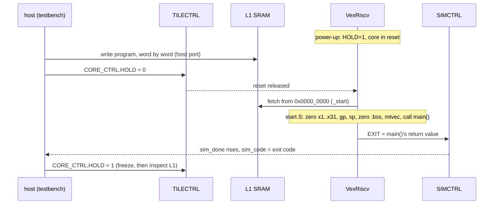

# Architecture

> The block diagram, memory map and register tables are generated from the
> code: [generated/architecture.md](generated/architecture.md). This page
> explains *why* it looks like that.

## Two levels: tile and SoC

```
SoC
├── tile0                       ← the unit that gets replicated later
│   ├── cpu      VexRiscv_Min   RV32I core (Verilog black box)
│   ├── l1       SRAM           dual-port, code + data + stack
│   ├── fetch    Decoder        ibus → L1 only
│   ├── arbiter  Arbiter        core dbus + host port → one bus
│   ├── decoder  Decoder        → L1 / TIMER / TILECTRL / ext
│   ├── timer    Timer          mtime/mtimecmp → timerInterrupt
│   └── ctrl     TileCtrl       tile id, core hold, bus errors
├── sysbus       Decoder        ext → UART / LEDS / SIMCTRL
├── uart, leds, simctrl
└── pins: host__*, uart_tx, leds, sim_done, sim_code
```

**Tile**: everything one core needs to run a kernel on its own. It has
exactly two links to the outside:
- `ext`, a Wishbone master: the tile reaching *out* (console, later DRAM and
  other tiles)
- `host`, a Wishbone slave: the outside reaching *in* (loading code, reading
  results)

These are the same two links a tile on a network on chip has. Going
many-core means putting a NoC between those links, without changing the tile.

**SoC**: the tiles plus whatever is shared between them.

## The bus

Every bus in the design has the same shape (`wishbone.Signature`):
32-bit data, 4 byte-enables (`sel`), 30-bit **word** address (byte address
`>> 2`), `cyc`/`stb`/`we` from the master, `ack`/`err`/`dat_r` back.

One transfer, as every slave in this repo implements it:

```
            ┌───┐   ┌───┐   ┌───┐   ┌───┐
clk       ──┘   └───┘   └───┘   └───┘   └──
               ┌───────────────┐
cyc, stb  ─────┘               └──────────   master holds the request...
adr, we   ═════╡  0x1000_0000  ╞══════════
                       ┌───────┐
ack       ─────────────┘       └──────────   ...until the slave acks once
dat_r     ═════════════╡ data  ╞══════════   (reads: data valid with ack)
               │ cycle 0 │ cycle 1 │
```

Rules that every slave follows (`register_slave()` in `bus/wishbone.py`):
1. ACK (or ERR) is high for **exactly one cycle** per request. A double ACK
   is the classic silent bug: the master takes it as the answer to its *next*
   request.
2. The answer comes one cycle after the request is seen, so the timing is the
   same for every slave.

### Decoder
Combinational routing: compare the address against each region (power-of-two
size, aligned base), forward `cyc`/`stb` only to the one that matches, and mux
its `ack`/`err`/`dat_r` back. A request that matches nothing gets a one-cycle
ERR from the decoder itself.

### Arbiter
Round-robin between masters, deciding **per transfer** (on ACK/ERR or when the
owner drops `cyc`). One busy master can't starve the others. With two busy
masters they strictly alternate (see `test_arbiter_alternates_between_busy_masters`).

### Bus errors and VexRiscv
VexRiscv's Wishbone bridges finish a transfer on **ACK only** and ignore ERR.
If a transfer ended in ERR alone, the core would wait for an ACK that never
comes and hang. The CPU wrapper therefore turns ERR into ACK (a bad load reads
0), and the tile records the event in `TILECTRL.BUSERR_COUNT` /
`BUSERR_ADDR`, where software or the host can see it. The `traps` program
tests this path.

A VexRiscv build with `catchAccessFault` would take a real access-fault trap
instead. That's a different core variant, not a different SoC.

## L1: one dual-port SRAM

| Port | Master | Access |
|---|---|---|
| A | core instruction fetch | read only |
| B | core loads/stores, host | read/write, byte enables |

Why not one single-port RAM behind the arbiter? Then every load or store would
stall instruction fetch, and the core's cycle count would depend on what the
host happens to be doing. With two ports, a program's timing depends only on
the program. FPGA block RAM is natively dual-port, so this costs nothing.

## Core boot



With a baked image (`SoC(firmware=...)`, used for FPGA builds), HOLD resets
to 0 and the core starts straight away.

## Interrupts

| Core pin | Source |
|---|---|
| `timerInterrupt` | tile TIMER: `mtime >= mtimecmp` |
| `softwareInterrupt` | tied 0 (inter-core interrupt later) |
| `externalInterruptArray[31:0]` | tied 0 (peripheral interrupts later) |

## Determinism

The roadmap leads to many cores working in lockstep on one job, so "same
program, same cycles" is treated as a feature and tested:
- no caches and no branch prediction in the core (VexRiscv_Min)
- dual-port L1, so fetch never contends with data
- every flop that matters has a reset value
- `start.S` zeroes x1..x31: VexRiscv's register file has no reset, and its
  power-up garbage would otherwise land on the stack the first time a
  function saves a callee-saved register

`test_deterministic_across_random_init` runs the same program twice with
Verilator filling every un-reset flop with different random values, and
requires identical cycle counts, console output and final L1 contents. That
test is what found the register-file issue: without the zeroing, cycles and
console matched but L1 differed in a few stack words.
