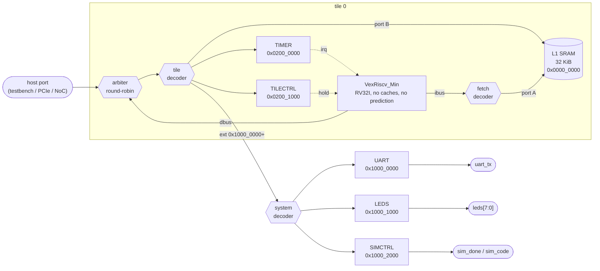

# rvgrid: generated architecture reference

> Generated by `python -m rvgrid diagram` from `rvgrid/config.py`. Do not edit.

## Block diagram

## Memory map

| Region | Base | End | Size | Scope | What |
|---|---|---|---|---|---|
| `L1` | `0x0000_0000` | `0x0000_7FFF` | 32 KiB | tile | Dual-port SRAM: code, data, stack |
| `TIMER` | `0x0200_0000` | `0x0200_0FFF` | 4 KiB | tile | Machine timer (mtime / mtimecmp) |
| `TILECTRL` | `0x0200_1000` | `0x0200_1FFF` | 4 KiB | tile | Tile id, core reset, bus errors |
| `UART` | `0x1000_0000` | `0x1000_0FFF` | 4 KiB | system | Console (8N1 transmitter) |
| `LEDS` | `0x1000_1000` | `0x1000_1FFF` | 4 KiB | system | 8 output pins |
| `SIMCTRL` | `0x1000_2000` | `0x1000_2FFF` | 4 KiB | system | Simulation exit code |
| *(anything else)* | | | | | bus error: ERR, recorded in `TILECTRL.BUSERR_*` |

## Registers

All registers are 32-bit; use `lw`/`sw`. C macros with the same names are in `build/include/soc.h`.

### TIMER @ `0x0200_0000`

| Offset | Register | Access | Reset | Description |
|---|---|---|---|---|
| `+0x00` | `TIMER_MTIME_LO` | ro | `0x0` | Cycle counter, low word |
| `+0x04` | `TIMER_MTIME_HI` | ro | `0x0` | Cycle counter, high word |
| `+0x08` | `TIMER_MTIMECMP_LO` | rw | `0xFFFFFFFF` | Compare value, low word |
| `+0x0C` | `TIMER_MTIMECMP_HI` | rw | `0xFFFFFFFF` | Compare value, high word |

### TILECTRL @ `0x0200_1000`

| Offset | Register | Access | Reset | Description |
|---|---|---|---|---|
| `+0x00` | `TILECTRL_TILE_ID` | ro | `0x0` | Index of this tile |
| `+0x04` | `TILECTRL_SCRATCH` | rw | `0x0` | Free 32-bit register (host <-> core mailbox) |
| `+0x08` | `TILECTRL_CORE_CTRL` | rw | `0x0` | bit0 HOLD: 1 = core held in reset |
| `+0x0C` | `TILECTRL_BUSERR_COUNT` | rw | `0x0` | Bus errors seen (write any value to clear) |
| `+0x10` | `TILECTRL_BUSERR_ADDR` | ro | `0x0` | Byte address of the first bus error since clear |

### UART @ `0x1000_0000`

| Offset | Register | Access | Reset | Description |
|---|---|---|---|---|
| `+0x00` | `UART_TXDATA` | wo | `0x0` | Write a byte to send it (dropped while TX_BUSY) |
| `+0x04` | `UART_STATUS` | ro | `0x0` | bit0 TX_BUSY: a frame is being shifted out |
| `+0x08` | `UART_DIVISOR` | rw | `0x1B2` | Clock cycles per bit (16 bits) |

### LEDS @ `0x1000_1000`

| Offset | Register | Access | Reset | Description |
|---|---|---|---|---|
| `+0x00` | `LEDS_OUT` | rw | `0x0` | Pin state, bits 7..0 |

### SIMCTRL @ `0x1000_2000`

| Offset | Register | Access | Reset | Description |
|---|---|---|---|---|
| `+0x00` | `SIMCTRL_EXIT` | wo | `0x0` | Write the exit code (0 = pass) to stop the simulation |
